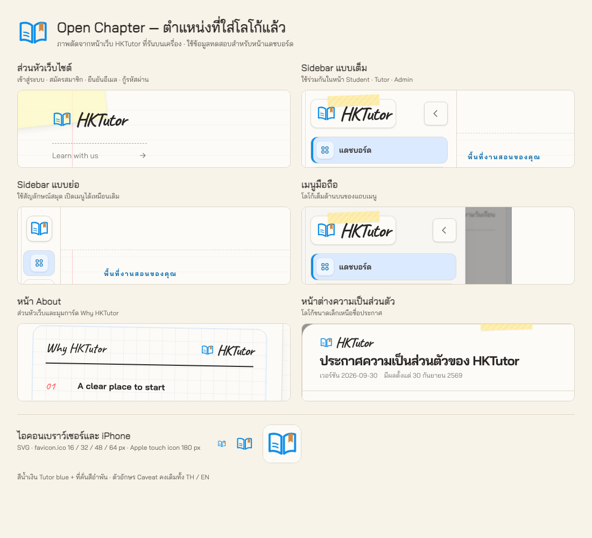

# Open Chapter logo placement evidence

Captured on 2026-11-11 from the running local HKTutor web client. The overview combines crops of
actual application screenshots with previews of the generated icon assets. Dashboard screenshots
use intercepted API fixtures for tutor, student, and admin sessions; they do not demonstrate live
backend integration or modify business records.

The overview shows the public/authentication header, expanded and collapsed dashboard sidebars,
mobile navigation, the About page card, the privacy notice, and browser/Apple touch icons.
The shared artwork is `apps/web/public/brand/open-chapter.svg`; the reusable component is
`apps/web/src/components/brand/brand-logo.tsx`.

## Verification

- Checked public/authentication pages at 320, 390, 768, and 1440 px, plus dashboard sidebar states
  for all three roles. The Latin wordmark retains Caveat in Thai and English.
- Browser icon metadata exposes the SVG, ICO, and 180 × 180 Apple touch icon. The ICO contains
  16, 32, 48, and 64 px images.
- Web unit tests: 685 passed. Focused login/student dashboard/tutor dashboard browser tests:
  90 passed across desktop, tablet, and mobile, excluding the existing notification request
  expectation described below. Web lint, formatting, and production build passed.
- The initial desktop run had 30 passing tests and one failure in `tutor-dashboard-ui.spec.ts`
  ("Notebook Focus uses existing data and keeps only contextual management links"). Its exact
  request-list assertion omits the existing `GET /notifications` call. The same failure was
  reproduced against the pre-logo commit `1231875` in an isolated local copy. Notification
  behavior and that unrelated test were left unchanged.
